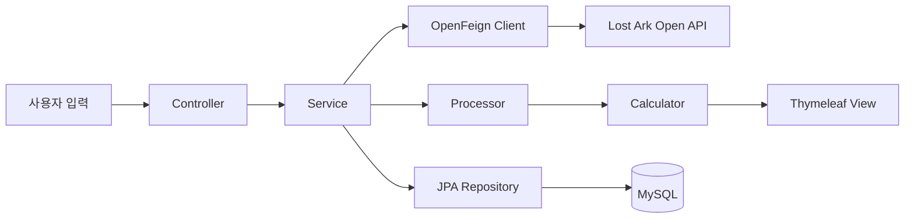

# LoaCalc

로스트아크 캐릭터와 거래소 데이터를 바탕으로 성장 비용을 계산하는 웹 서비스입니다. 공식 API의 원시 데이터를 수집하는 단계와 게임 규칙에 따라 비용을 계산하는 단계를 분리해, 시세와 시스템 변경에 대응할 수 있도록 구성했습니다.

## 주요 기능

- 캐릭터 정보와 보유 장비 조회
- 장비 상태와 성장 단계에 따른 비용 계산
- 경매장·거래소 시세 조회 및 기준 가격 관리
- 각인서와 장비 기준 데이터 저장
- 주기적인 가격 데이터 갱신
- Thymeleaf 기반 조회·결과 화면

## 처리 흐름



## 구현 포인트

### 계산 책임 분리

외부 API 호출, 응답 가공, 비용 계산을 각각 `feign`, `processor`, `calculator` 패키지로 나눴습니다. 계산 규칙이 바뀌어도 API 호출 코드와 화면 흐름에 미치는 영향을 줄이는 것이 목적입니다.

### 변하는 게임 데이터 관리

재료 시세와 기준 가격은 외부 데이터와 DB 데이터를 함께 사용합니다. `scheduler`가 변동 데이터를 갱신하고, JPA Repository가 계산에 필요한 기준 데이터를 제공합니다.

### 게임 시스템 변경 반영

상급 재련 개편과 아이템 레벨별 장비 능력치 변경을 계산 모델에 반영했습니다. 규칙을 기능별 객체로 나눠 수정 범위를 좁혔습니다.

## 기술 스택

- Java 19
- Spring Boot 3.3.4
- Spring Data JPA
- Spring Cloud OpenFeign
- MySQL, H2
- Thymeleaf
- Gradle
- Docker

## 프로젝트 구조

```text
src/main/java/jmna/loacalc
├─ calculator   # 성장 비용 계산 규칙
├─ controller   # 웹 요청과 화면 흐름
├─ entity       # 기준 데이터 모델
├─ feign        # Lost Ark Open API 연동
├─ processor    # API 응답 가공
├─ repository   # 데이터 조회·저장
├─ scheduler    # 가격 데이터 갱신
└─ service      # 기능 흐름 조합
```

## 실행 방법

### 준비 사항

- Java 19
- MySQL
- [Lost Ark Open API](https://developer-lostark.game.onstove.com/)에서 발급한 API Key

DB 접속 정보와 API Key를 Spring 설정으로 구성한 뒤 실행합니다. 인증 정보는 저장소에 커밋하지 않습니다.

```bash
./gradlew bootRun
```

Windows에서는 다음 명령을 사용할 수 있습니다.

```powershell
.\gradlew.bat bootRun
```

## 관련 프로젝트

- [LoaApi](https://github.com/JM-Na/LoaApi): Lost Ark Open API의 주요 영역을 Spring API로 중계하는 프로젝트


