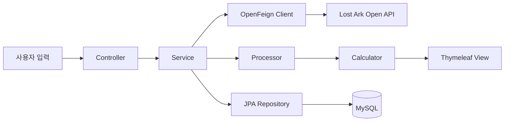

# LoaCalc

로스트아크 캐릭터와 거래소 데이터를 바탕으로 성장 비용을 계산하는 웹 서비스입니다. 공식 API의 원시 데이터를 수집하는 단계와 게임 규칙에 따라 비용을 계산하는 단계를 분리해, 시세와 시스템 변경에 대응할 수 있도록 구성했습니다.

## 주요 기능

- 캐릭터 정보와 보유 장비 조회
- 장비 상태와 성장 단계에 따른 비용 계산
- 경매장·거래소 시세 조회 및 기준 가격 관리
- 각인서와 장비 기준 데이터 저장
- 캐릭터 검색 시 재련 재료의 거래소 전일 평균가를 읽어 저장
- Thymeleaf 기반 조회·결과 화면

## 처리 흐름



## 구현 포인트

### 계산 책임 분리

외부 API 호출, 응답 가공, 비용 계산을 각각 `feign`, `processor`, `calculator` 패키지로 나눴습니다. 계산 규칙이 바뀌어도 API 호출 코드와 화면 흐름에 미치는 영향을 줄이는 것이 목적입니다.

### 변하는 게임 데이터 관리

[검색 서비스](src/main/java/jmna/loacalc/service/TestService.java)는 OpenFeign으로 프로필·장비·각인 등 캐릭터 정보를 한 번에 받고, 경매장과 거래소 가격은 별도로 조회합니다. 재련 계산기는 JPA 저장소에서 재료 이름으로 가격을 읽습니다. [가격 갱신 스케줄러](src/main/java/jmna/loacalc/scheduler/loaApiScheduler.java)의 정각 호출부는 주석 처리돼 있습니다.

### 게임 시스템 변경 반영

현재 10단계인 장비의 30단계 후보에는 10→20과 20→30 두 구간의 예상 비용을 누적합니다. [재련 계산기](src/main/java/jmna/loacalc/calculator/v2/WeaponHoneCalculator.java)가 만든 후보는 [결과 표](src/main/resources/templates/main.html)에서 예상 공격력 상승률, 비용, 만 골드당 상승률로 비교할 수 있습니다. 계산식의 비용 합계에서 파편 가격은 빠져 있고, 구간을 일부 진행한 경우에도 다음 목표까지 한 구간의 비용을 사용합니다.

## 기술 스택

- Java 19
- Spring Boot 3.3.4
- Spring Data JPA
- Spring Cloud OpenFeign
- MySQL, H2
- Thymeleaf
- Gradle
- Docker

## 프로젝트 구조

```text
src/main/java/jmna/loacalc
├─ calculator   # 성장 비용 계산 규칙
├─ controller   # 웹 요청과 화면 흐름
├─ entity       # 기준 데이터 모델
├─ feign        # Lost Ark Open API 연동
├─ processor    # API 응답 가공
├─ repository   # 데이터 조회·저장
├─ scheduler    # 주기 작업 등록
└─ service      # 기능 흐름 조합
```

## 실행 방법

### 준비 사항

- Java 19
- MySQL
- [Lost Ark Open API](https://developer-lostark.game.onstove.com/)에서 발급한 API Key

로컬 Spring 설정에 `smilegate.url`(Lost Ark Open API 기본 주소), `smilegate.jwt`(발급받은 토큰 원문), `spring.datasource.url`, `spring.datasource.username`, `spring.datasource.password`를 지정합니다. MySQL 사용 시 애플리케이션이 읽고 쓸 데이터베이스와 테이블을 준비합니다. 최초 로컬 개발 DB는 `spring.jpa.hibernate.ddl-auto=update`로 테이블을 구성할 수 있습니다.

```bash
sh gradlew bootRun
```

Windows에서는 다음 명령을 사용할 수 있습니다.

```powershell
.\gradlew.bat bootRun
```

서버를 시작한 뒤 `GET /search?characterName=캐릭터이름`으로 검색합니다. 한글 이름은 URL 인코딩해 전달합니다. [재련 테스트](src/test/java/jmna/loacalc/calculator/WeaponHoneCalculatorTest.java)는 계산값을 출력하며, 실제 게임 수치를 기대값으로 대조하는 회귀 테스트는 포함하지 않습니다.

## 관련 프로젝트

- [LoaApi](https://github.com/JM-Na/LoaApi): Lost Ark Open API의 주요 영역을 Spring API로 중계하는 프로젝트
